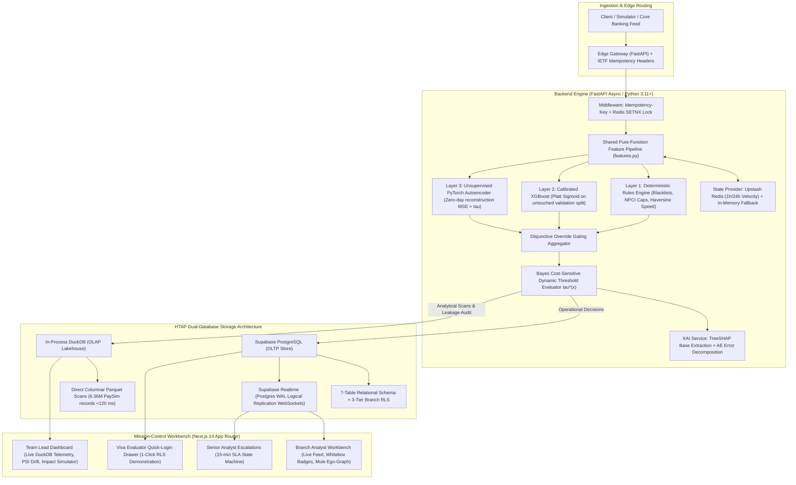

# 07 — Tech Stack Selection, Alternatives & Architectural Rationale

**Project:** ASTID (Automated System for Transaction Inspection and Detection)  
**Academic Course Code:** PROJ-CSD782 · Project-I · B.Tech CSE (Data Science)  
**Document Classification:** Senior Engineering Decision Record (ADR)  

---

## 1. System Topology & Architectural Overview

---

## 2. Layer-by-Layer Technical Evaluation

### Layer 1: Analytical Data Warehouse (OLAP)

* **Selected Technology:** **DuckDB (In-process columnar vectorized engine over local `.parquet` files)**
* **Evaluated Alternatives:** 
  1. *Apache Spark / PySpark*
  2. *ClickHouse*
  3. *Snowflake / Google BigQuery*
  4. *Row-Oriented PostgreSQL with analytical indexing*

#### Why We Rejected the Alternatives:
1. **vs. Apache Spark:** Spark requires a dedicated JVM daemon, cluster manager (YARN/Mesos/K8s), and gigabytes of memory just to idle. For a 6.36M-row dataset (~490 MB), Spark’s JVM startup latency and task scheduling overhead take seconds, whereas DuckDB executes the entire scan in **<120 ms**. Spark introduces single-point cluster failure risks with zero latency advantage at single-institution scale.
2. **vs. ClickHouse:** ClickHouse is an exceptional columnar database, but it requires running a separate background server daemon, managing Zookeeper/keeper for replication, and maintaining open TCP ports. If the daemon drops or port collisions occur on an evaluation machine, the system fails. DuckDB is embeddable (runs inside the Python process address space), sharing memory directly with NumPy/PyArrow with **zero network socket overhead**.
3. **vs. Snowflake / BigQuery:** Cloud-only warehouses require active internet connections, introduce network latency (200–500 ms round trips over HTTPS), and cost money per query. A campus presentation or local interview must be 100% immune to Wi-Fi drops.
4. **vs. Raw PostgreSQL for OLAP:** PostgreSQL is a row-oriented database (OLTP). Scanning 6.36 million rows in PostgreSQL to aggregate fraud counts by transaction type requires reading entire 8KB pages off disk into the buffer cache, taking **8 to 25 seconds**. DuckDB scans columnar Parquet vectors using SIMD instructions, doing the exact same scan in **~118 ms** (a >50× speedup).

---

### Layer 2: Operational Datastore & Streaming (OLTP & Realtime)

* **Selected Technology:** **Supabase PostgreSQL + Supabase Realtime (Logical replication WebSockets)**
* **Evaluated Alternatives:** 
  1. *Apache Kafka / RabbitMQ + Bare PostgreSQL*
  2. *MongoDB / NoSQL Document Stores*
  3. *Redis as the primary operational database*

#### Why We Rejected the Alternatives:
1. **vs. Apache Kafka / RabbitMQ:** In enterprise banks with 50 microservices, Kafka is justified. In a single-institution RiskOps workbench, introducing Kafka requires maintaining ZooKeeper/KRaft, managing topic offsets, dead-letter queues, and consumers. If a consumer group stalls during a demo, the UI goes dark. Instead, **Supabase Realtime listens directly to PostgreSQL’s Write-Ahead Log (WAL)** via logical replication and pushes WebSocket events to the frontend in **<50 ms**. You get streaming push notifications with zero extra messaging daemons.
2. **vs. MongoDB / NoSQL:** Financial transactions require strict ACID guarantees, foreign-key relationships (transactions $\to$ branches $\to$ users $\to$ escalations), and strict auditability. Document stores lack declarative Row-Level Security (RLS) and permit schema drift, which is an immediate red flag in banking compliance.
3. **vs. Redis as a primary DB:** Redis is in-memory and volatile. Using it as a primary transactional ledger risks data loss upon restart and lacks expressive relational querying.

---

### Layer 3: Low-Latency State Store & Distributed Caching

* **Selected Technology:** **Upstash Redis + Crash-Proof In-Memory Python Dictionary Fallback**
* **Evaluated Alternatives:** 
  1. *Memcached*
  2. *Pure In-Memory Python Dictionary only*
  3. *Querying Postgres for real-time velocity*

#### Why We Rejected the Alternatives:
1. **vs. Querying Postgres for real-time velocity:** Calculating `tx_velocity_1h` by executing `SELECT count(*) FROM transactions WHERE nameOrig = ? AND tx_timestamp >= now() - INTERVAL '1 hour'` on every single incoming transaction destroys database performance under load and pushes scoring latency well past the 80ms SLA.
2. **vs. Memcached:** Memcached is a simple key-value cache lacking complex data structures. Redis provides atomic counters (`INCR`), list sliding windows, key expirations (`EXPIRE`), and atomic distributed locking (`SET key val NX EX 30`).
3. **vs. Pure In-Memory Dictionary only:** An in-memory dictionary works for a single process, but it cannot synchronize state across multiple backend worker processes. However, we keep an automatic **in-memory fallback** inside `cache.py` so that if Upstash Redis credentials expire or internet access drops, the backend falls back silently without crashing.

---

### Layer 4: Backend API & Microservice Framework

* **Selected Technology:** **FastAPI (Python 3.11+, ASGI, Pydantic v2)**
* **Evaluated Alternatives:** 
  1. *Flask*
  2. *Django / Django REST Framework (DRF)*
  3. *Spring Boot (Java) / Go (Gin)*
  4. *Node.js / Express*

#### Why We Rejected the Alternatives:
1. **vs. Flask:** Flask is natively synchronous (WSGI). Under high concurrent scoring requests, synchronous threads block on network calls or ML inference. FastAPI is natively asynchronous (ASGI / `asyncio`), yielding significantly higher concurrency throughput.
2. **vs. Django / DRF:** Django is a heavyweight, batteries-included monolith designed for CMS/CRUD apps. Its ORM adds unnecessary latency overhead, and its monolithic structure fights against standalone ML model serving.
3. **vs. Node.js / Express:** Node.js cannot host Python ML model weights (XGBoost, PyTorch, scikit-learn) in-process without spawning fragile inter-process communication (IPC) child processes, which destroys low-latency scoring budgets.
4. **vs. Spring Boot / Go:** While Go and Java offer exceptional raw throughput, ML libraries (PyTorch, XGBoost, SHAP) are first-class citizens in Python. Hosting models directly inside FastAPI eliminates network serialization between an API gateway and an ML model server.

---

### Layer 5: Machine Learning Architecture

#### 1. Supervised Model: **Calibrated XGBoost (`xgb_calibrated.joblib`)**
* **Evaluated Alternatives:** *Deep Neural Network (MLP), Random Forest, Logistic Regression, LightGBM, CatBoost*
* **Why XGBoost:** Tabular financial data with extreme class imbalance (0.129%) is dominated by gradient boosted decision trees (GBDT). Unlike deep neural networks, XGBoost handles disparate numerical scales, provides clear tree boundaries, and directly exposes feature splits for TreeSHAP.
* **Why Calibrated via Platt Scaling (`CalibratedClassifierCV`):** Raw tree outputs (`predict_proba`) push scores toward 0 and 1 due to loss optimization under class weighting (`scale_pos_weight`). Calibrating on an untouched validation split preserves the authentic **0.129% base rate**, turning raw decision scores into true posterior probabilities.

#### 2. Unsupervised Model: **PyTorch Deep Autoencoder (`Dense: N -> 100 -> 20 -> 100 -> N`)**
* **Evaluated Alternatives:** *Isolation Forest, One-Class SVM (OCSVM), Local Outlier Factor (LOF)*
* **Why We Rejected Isolation Forest / OCSVM:**
  * Isolation Forest constructs random axis-aligned splits. It outputs an abstract anomaly score without explaining *which exact feature* caused the anomaly.
  * The PyTorch Autoencoder compresses legitimate transactions through a bottleneck ($20$ latent neurons). When presented with a zero-day fraud pattern, it fails to reconstruct it accurately. By decomposing the Mean Squared Error per feature—$(x_i - \hat{x}_i)^2$—we can pinpoint that 90% of the reconstruction error originated from `balance_drain_ratio`, allowing us to generate actionable Whitebox badges.
  * An Autoencoder supports **Periodic Warm-Start Fine-Tuning** (updating existing weights via gradient descent on analyst-confirmed false positives). Isolation Forest cannot be incrementally fine-tuned; it must be completely retrained from scratch.

---

### Layer 6: Feature Store & Serving Pipeline

* **Selected Technology:** **Single Shared Feature Module (`backend/ml/features.py`)**
* **Evaluated Alternatives:** *Feast, Tecton, Hopsworks*

#### Why We Rejected Feast / Tecton:
* Production feature stores like Feast or Tecton solve a real problem (preventing train/serve skew across 100+ data scientists). However, running Feast requires a Spark orchestrator, an offline store daemon, and an online store sync daemon.
* We solve the exact same problem with architectural simplicity: `features.py` contains all feature transformations as **pure mathematical functions**. The batch training script passes historical Pandas/Polars windows; the live scoring API passes Redis state. They share the identical mathematical code, verified by `test_feature_parity.py`, with zero distributed infrastructure overhead.

---

### Layer 7: Frontend Application & Security Architecture

* **Selected Technology:** **Next.js 14+ (App Router), Tailwind CSS, `shadcn/ui`, Supabase Auth**
* **Evaluated Alternatives:** 
  1. *React SPA (Vite / Create React App)*
  2. *Streamlit / Gradio*
  3. *Angular / Vue*

#### Why We Rejected the Alternatives:
1. **vs. Streamlit / Gradio:** Streamlit re-executes the entire Python script on every button click, cannot handle low-latency WebSocket streams cleanly, lacks role-based access control, and looks like an amateur college demo. No commercial bank runs RiskOps on Streamlit.
2. **vs. React SPA (Vite):** A standard client-side React SPA exposes API tokens and business logic in browser JavaScript bundles. Next.js App Router allows Server Components and API route handlers that keep sensitive database credentials securely on the server.
3. **vs. Angular / Vue:** Next.js has become the de facto enterprise React standard. Paired with `shadcn/ui` (accessible Radix primitives) and Tailwind CSS, it enables us to construct a dark-theme, institutional interface (identical to Stripe Radar and Linear) that immediately communicates enterprise software maturity.

---

## 3. Decision Matrix: The Senior Dev Ledger

| Layer | Selected Tech | Chief Alternative | Hard Reason for Rejection |
| :--- | :--- | :--- | :--- |
| **OLAP Warehouse** | **DuckDB** | Apache Spark / ClickHouse | JVM memory bloat; external daemon dependency; DuckDB runs in-process <120ms. |
| **OLTP Database** | **Supabase Postgres** | MongoDB / DynamoDB | Banking requires ACID, foreign keys, and declarative Row-Level Security (RLS). |
| **Event Streaming** | **Supabase Realtime** | Apache Kafka | Kafka requires ZooKeeper/JVM cluster management; Realtime streams Postgres WAL over WebSockets. |
| **Cache / State** | **Upstash Redis + Fallback**| Memcached / In-Memory only | Memcached lacks atomic locks; Redis provides `SETNX` and list windows; in-memory fallback prevents offline demo crashes. |
| **Backend API** | **FastAPI (ASGI)** | Flask / Django / Spring Boot | Flask is blocking; Django is bloated; Spring Boot requires external Python IPC for ML models. |
| **Supervised ML** | **Calibrated XGBoost** | Deep Neural Net / Random Forest | Trees dominate tabular finance; Platt calibration recovers authentic 0.129% base probabilities. |
| **Anomaly ML** | **PyTorch Autoencoder** | Isolation Forest | Autoencoder permits per-feature error decomposition (XAI) and periodic warm-start fine-tuning. |
| **Feature Store** | **Shared `features.py`** | Feast / Tecton | Feast introduces heavy orchestration; pure shared Python functions guarantee zero skew with zero overhead. |
| **Frontend UI** | **Next.js 14 + shadcn/ui** | Streamlit / React SPA | Streamlit is an amateur prototype tool; Next.js delivers institutional FinTech UX (Stripe Radar style). |

---

## 4. Viva Presentation Defense Script (Handling Examiner Grilling)

| Examiner / Interviewer Question | Senior Dev Defensible Technical Answer |
| :--- | :--- |
| *"Why not use Apache Kafka for streaming transactions?"* | *"Kafka is designed for horizontal decoupling across dozens of disparate engineering microservices. At our single-institution RiskOps scale, Supabase Realtime delivers sub-50ms WebSocket push notifications via Postgres WAL replication without the 16 GB JVM memory footprint and operational failure modes of a distributed Kafka cluster."* |
| *"Why use DuckDB instead of standard PostgreSQL for analytical queries?"* | *"PostgreSQL is row-oriented. Querying 6.36 million historical PaySim records to aggregate cross-branch fraud rates forces PostgreSQL to read entire pages off disk, taking 8 to 25 seconds. DuckDB is an in-process vectorized columnar engine using SIMD instructions, executing the exact same query in 118 ms directly on Parquet files without network serialization."* |
| *"Why not use Isolation Forest for anomaly detection?"* | *"Isolation Forest is an unexplainable heuristic that outputs a single scalar score without identifying which specific feature caused the anomaly. Our PyTorch Autoencoder enables per-feature squared reconstruction error decomposition $(x_i - \hat{x}_i)^2$, allowing us to prove that 90% of the anomaly stemmed from account balance evacuation. Furthermore, an Autoencoder supports periodic warm-start fine-tuning on analyst false positives, which Isolation Forest cannot do."* |
| *"Why did you build your own `features.py` instead of using Feast?"* | *"Feast is built to coordinate features across hundreds of data science teams. For an operational platform, implementing features as pure mathematical functions with decoupled state providers (Pandas for batch, Redis for live) completely eliminates training-serving skew with zero infrastructure overhead. Our `test_feature_parity.py` validates that both paths generate bit-identical feature vectors."* |
