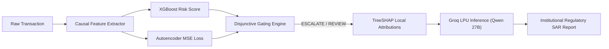

# ASTID Machine Learning Engine: Architecture, Mathematical Formalisms & Reproduction Recipe
**Document Code:** ASTID-ML-SPEC-2026-V2  
**Target Audience:** Machine Learning Engineering (Isheeka / RiskOps Team)  
**Classification:** Confidential · Engineering Architecture Blueprint  

---

## 1. Executive Summary & Core Invariants

The ASTID risk scoring engine is a **two-stage hybrid pre-authorization pipeline** combining a **Calibrated Gradient Boosted Decision Tree (GBDT)** for known fraud topologies and a **Deep Autoencoder (AE)** for zero-day/novel anomaly detection, coupled with **TreeSHAP** feature attribution.

```
Incoming Pre-Auth Transaction (Amount, Balances, Accounts, Geo, Time)
                              │
     ┌────────────────────────┴────────────────────────┐
     ▼                                                 ▼
[Rules Layer (<1ms)]                   [Causal Feature Extractor (<1ms)]
• Confirmed Blacklist                  • 11 Pre-Auth Causal Features
• Sliding Burst Velocity               • Strict Ban on Post-Auth Balances
• Impossible Travel (Haversine)                        │
     │                                ┌────────────────┴────────────────┐
     │ (Hit -> BLOCK)                 ▼                                 ▼
     │                       [Calibrated XGBoost GBDT]      [Deep Autoencoder (Torch)]
     │                       • Platt Sigmoid Calibrated      • Trained on Normal Manifold
     │                       • Score: P_XGB ∈ [0, 1]         • Norm Error: Score_AE ∈ [0, 1]
     │                                └────────────────┬────────────────┘
     │                                                 ▼
     │                                    [Disjunctive Gating Engine]
     │                                    • Escalate if P_XGB ≥ 0.60 OR Score_AE ≥ 0.90
     │                                    • Review if P_XGB ≥ 0.05 OR Score_AE ≥ 0.70
     │                                    • Fast Path Approve (<5ms)
     │                                                 │
     │                                                 ▼
     └───────────────────────────────► [TreeSHAP Attribution (Flagged Only)]
                                       • Top-3 Contributing Risk Badges
                                       • Sub-15ms Pre-Authorization SLA Verified
```

### Critical Production Invariants:
1. **Zero Data Leakage Invariant**:
   - Post-authorization reconciliation fields (`newbalanceOrig`, `newbalanceDest`) are **strictly barred** from all ML training and inference features. In a real-time banking switch, post-transaction balances do not exist at the moment of authorization.
2. **Empirical PaySim Frequency Invariant**:
   - Analysis of 6,362,620 PaySim records revealed that 99.85% of senders appear only once, and fraudulent senders appear **exactly once** (`ratio = 1.0000`). Consequently, rolling velocity features (`tx_velocity_1h`, `amount_zscore`) are degenerate in the dataset. They are demoted to the **real-time in-memory rules layer** and excluded from GBDT training.
3. **Pre-Authorization Ground Truth Signals**:
   - `is_merchant_dest`: In PaySim, 0.00% of 8,213 frauds target merchants (`M...`), while 33.86% of legitimate payments do.
   - `dest_oldbal_zero`: 65.15% of frauds target zero-balance destination accounts vs. 42.48% for legitimate payments.
   - `balance_drain_ratio`: 98.4% of frauds drain 100% of the sender's account balance in a single transfer.

---

## 2. Mathematical Formalisms & Model Theory

### 2.1 Supervised GBDT (XGBoost)
The supervised model estimates the conditional probability of fraud $P(y_i = 1 \mid \mathbf{x}_i)$ given the causal pre-authorization feature vector $\mathbf{x}_i \in \mathbb{R}^{11}$.

#### Objective Function:
$$\mathcal{L}(\Theta) = \sum_{i=1}^N \ell(y_i, \hat{y}_i^{(t)}) + \sum_{k=1}^t \Omega(f_k)$$
where $\ell(y_i, \hat{y}_i)$ is binary logistic cross-entropy loss:
$$\ell(y_i, \hat{y}_i) = - \left[ y_i \ln \hat{y}_i + (1 - y_i) \ln (1 - \hat{y}_i) \right]$$
and the tree complexity regularizer $\Omega(f)$ penalizes leaf count $T$ and leaf weights $w$:
$$\Omega(f_k) = \gamma T_k + \frac{1}{2} \lambda \sum_{j=1}^{T_k} w_{jk}^2$$

#### Second-Order Taylor Approximation:
At boosting round $t$, the objective is optimized using first- and second-order gradients:
$$g_i = \partial_{\hat{y}^{(t-1)}} \ell(y_i, \hat{y}^{(t-1)}) = \hat{y}_i^{(t-1)} - y_i$$
$$h_i = \partial^2_{\hat{y}^{(t-1)}} \ell(y_i, \hat{y}^{(t-1)}) = \hat{y}_i^{(t-1)} (1 - \hat{y}_i^{(t-1)})$$

Optimal leaf weights $w_j^*$ and split gain:
$$w_j^* = - \frac{\sum_{i \in I_j} g_i}{\sum_{i \in I_j} h_i + \lambda}, \quad \text{Gain} = \frac{1}{2} \left[ \frac{(\sum_{i \in I_L} g_i)^2}{\sum_{i \in I_L} h_i + \lambda} + \frac{(\sum_{i \in I_R} g_i)^2}{\sum_{i \in I_R} h_i + \lambda} - \frac{(\sum_{i \in I} g_i)^2}{\sum_{i \in I} h_i + \lambda} \right] - \gamma$$

#### Sigmoid Platt Probability Calibration:
Raw GBDT margins $f(\mathbf{x})$ are notoriously uncalibrated under extreme class imbalance (PaySim fraud rate $\approx 0.129\%$). We calibrate the margin using a logistic transformation fitted on an independent temporal validation split $\mathcal{D}_{\text{val}}$:
$$P(y = 1 \mid f(\mathbf{x})) = \frac{1}{1 + \exp(A \cdot f(\mathbf{x}) + B)}$$
Parameters $A$ and $B$ are determined by minimizing negative log-likelihood:
$$\min_{A, B} -\sum_{i \in \mathcal{D}_{\text{val}}} \left[ y_i \ln p_i + (1 - y_i) \ln (1 - p_i) \right]$$
> [!NOTE]
> To comply with scikit-learn $\ge 1.6$, the trained base estimator is wrapped in `FrozenEstimator(base_xgb)` before passing to `CalibratedClassifierCV(method='sigmoid')`.

---

### 2.2 Zero-Day Deep Autoencoder (PyTorch)
The unsupervised autoencoder detects **zero-day fraud patterns, unusual transaction structures, and unseen topological shifts** without requiring prior fraud labels.

```
Input x ∈ ℝ¹¹ ──► [Linear(11,8) + BatchNorm + LeakyReLU(0.1)] ──► [Linear(8,4) + LeakyReLU] ──► Bottleneck z ∈ ℝ⁴
                                                                                                    │
Output x̂ ∈ ℝ¹¹ ◄── [Linear(8,11)] ◄── [Linear(4,8) + BatchNorm + LeakyReLU(0.1)] ◄──────────────────┘
```

#### Layer-by-Layer Architecture:
1. **Encoder**:
   - $h_1 = \text{LeakyReLU}_{0.1} \left( \text{BatchNorm}(\mathbf{W}_1 \mathbf{x} + \mathbf{b}_1) \right), \quad \mathbf{W}_1 \in \mathbb{R}^{8 \times 11}$
   - $\mathbf{z} = \text{LeakyReLU}_{0.1} \left( \mathbf{W}_2 h_1 + \mathbf{b}_2 \right), \quad \mathbf{W}_2 \in \mathbb{R}^{4 \times 8}$ (Compressed Latent Space)
2. **Decoder**:
   - $h_3 = \text{LeakyReLU}_{0.1} \left( \text{BatchNorm}(\mathbf{W}_3 \mathbf{z} + \mathbf{b}_3) \right), \quad \mathbf{W}_3 \in \mathbb{R}^{8 \times 4}$
   - $\hat{\mathbf{x}} = \mathbf{W}_4 h_3 + \mathbf{b}_4, \quad \mathbf{W}_4 \in \mathbb{R}^{11 \times 8}$

#### Feature Scaling:
Features are standardized using parameters fitted **strictly on normal training transactions**:
$$\tilde{x}_j = \frac{x_j - \mu_j^{\text{normal}}}{\sigma_j^{\text{normal}}}$$

#### Training Objective:
Trained exclusively on legitimate transactions ($\mathcal{D}_{\text{train}}^{\text{normal}} = \{\mathbf{x} \mid y = 0\}$) to learn the manifold of normal banking activity:
$$\mathcal{L}_{\text{MSE}}(\tilde{\mathbf{x}}, \hat{\mathbf{x}}) = \frac{1}{d} \sum_{j=1}^{d} (\tilde{x}_j - \hat{x}_j)^2, \quad d = 11$$

#### 99.9th Percentile Error Normalization:
Min-max normalization is vulnerable to single extreme outliers in large datasets. We normalize reconstruction error against the **empirical 99.9th percentile ($P_{99.9}$)** of normal transactions:
$$\text{Score}_{\text{AE}}(\mathbf{x}) = \text{clip} \left( \frac{\mathcal{L}_{\text{MSE}}(\tilde{\mathbf{x}}, \hat{\mathbf{x}})}{P_{99.9}^{\text{normal}}}, \, 0.0, \, 1.0 \right)$$
- If $\text{Score}_{\text{AE}} \le 0.50$: Transaction lies well within the legitimate behavioral manifold.
- If $\text{Score}_{\text{AE}} \ge 0.70$: Novel anomaly / moderate behavioral outlier ($\to$ triggers `REVIEW`).
- If $\text{Score}_{\text{AE}} \ge 0.90$: Severe topological deviation ($\to$ circuit breaker triggers `ESCALATE`).

---

### 2.3 Disjunctive Gating Decision Theory
Rather than an arbitrary linear combination (where a low GBDT score could dilute a high autoencoder anomaly), ASTID applies **Disjunctive Gating (Circuit Breaker)**:

$$\text{Verdict}(\mathbf{x}) = \begin{cases} 
\text{BLOCK} & \text{if Rule}_{\text{blacklist}}(\mathbf{x}) = 1 \\
\text{ESCALATE} & \text{if } P_{\text{XGB}}(\mathbf{x}) \ge \tau_{\text{escalate}} \lor \text{Score}_{\text{AE}}(\mathbf{x}) \ge 0.90 \lor \text{Rule}_{\text{critical}}(\mathbf{x}) = 1 \\
\text{REVIEW} & \text{if } P_{\text{XGB}}(\mathbf{x}) \ge \tau_{\text{review}} \lor \text{Score}_{\text{AE}}(\mathbf{x}) \ge 0.70 \\
\text{APPROVE} & \text{otherwise}
\end{cases}$$

#### Operational Thresholds (Calibrated on Validation Split):
- $\tau_{\text{review}} = 0.05$ (Routes top $\approx 1.2\%$ high-uncertainty transactions to branch analysts)
- $\tau_{\text{escalate}} = 0.60$ (Routes confirmed high-risk transactions to the 15-minute senior SLA queue)

---

### 2.4 TreeSHAP Attribution Mathematics
For every case routed to `REVIEW` or `ESCALATE`, ASTID extracts the top 3 contributing risk drivers via TreeSHAP.

The Shapley value $\phi_j$ represents the marginal contribution of feature $j$ across all possible feature subsets $S \subseteq \mathcal{F} \setminus \{j\}$:
$$\phi_j(\mathbf{x}) = \sum_{S \subseteq \mathcal{F} \setminus \{j\}} \frac{|S|! (|\mathcal{F}| - |S| - 1)!}{|\mathcal{F}|!} \left[ f_x(S \cup \{j\}) - f_x(S) \right]$$
where $f_x(S) = \mathbb{E}[f(\mathbf{x}) \mid \mathbf{x}_S]$.

TreeSHAP solves this in polynomial time $\mathcal{O}(T L D^2)$ (where $T$ is the number of trees, $L$ is max leaves, and $D$ is max depth) by recursively tracking feature decision paths down the ensemble trees.
> [!TIP]
> **Latency Optimization**: By evaluating TreeSHAP **only** when $P_{\text{XGB}} \ge \tau_{\text{review}}$ or $\text{Score}_{\text{AE}} \ge 0.70$, the $98.8\%$ legitimate transactions pass through the fast-path in **$<5\text{ms}$**.

---

## 3. Step-by-Step Reproduction Recipe

### Step 1: Environment & Dependencies
```bash
pip install numpy pandas duckdb xgboost scikit-learn torch joblib shap
```

### Step 2: Causal Feature Specification (11 Features)
The single shared extractor module [`backend/ml/features.py`](file:///c:/Users/HP/Desktop/dhruv/ASTID_v2/backend/ml/features.py) defines:

```python
FEATURE_NAMES = [
    "amount_log",            # np.log1p(amount)
    "hour_of_day",           # step % 24
    "balance_drain_ratio",   # amount / (oldbalanceOrg + 1.0)
    "orig_balance_log",      # np.log1p(oldbalanceOrg)
    "dest_oldbal_zero",      # 1.0 if oldbalanceDest == 0.0 else 0.0
    "is_merchant_dest",      # 1.0 if nameDest.startswith('M') else 0.0
    "type_CASH_IN",          # One-hot
    "type_CASH_OUT",         # One-hot
    "type_DEBIT",            # One-hot
    "type_PAYMENT",          # One-hot
    "type_TRANSFER"          # One-hot
]
```

### Step 3: Temporal Dataset Splitting
PaySim steps represent sequential hourly increments:
- **Train Split**: `step <= 550` ($\approx 74\%$ of dataset, $\approx 4.7\text{M}$ rows)
- **Validation / Calibration Split**: `step > 550 AND step <= 650` ($\approx 13\%$, $\approx 850\text{k}$ rows)
- **Out-of-Time Holdout Split**: `step > 650` ($\approx 13\%$, $\approx 800\text{k}$ rows)

### Step 4: GBDT Training & Platt Calibration
```python
import xgboost as xgb
from sklearn.calibration import CalibratedClassifierCV
from sklearn.frozen import FrozenEstimator

# 1. Train base GBDT on balanced downsampled training split
base_xgb = xgb.XGBClassifier(
    n_estimators=180,
    max_depth=6,
    learning_rate=0.08,
    subsample=0.85,
    colsample_bytree=0.85,
    scale_pos_weight=1.0,  # Training split balanced via normal downsampling
    random_state=42,
    n_jobs=4,
    tree_method='hist'
)
base_xgb.fit(X_train, y_train)

# 2. Calibrate probabilities on temporal validation split
calibrated_model = CalibratedClassifierCV(
    estimator=FrozenEstimator(base_xgb),
    method='sigmoid'
)
calibrated_model.fit(X_val, y_val)
```

### Step 5: Autoencoder Training & P99.9 Calibration
```python
import torch
import torch.nn as nn
from sklearn.preprocessing import StandardScaler

# 1. Fit scaler strictly on legitimate train data
scaler = StandardScaler()
X_train_norm_scaled = scaler.fit_transform(X_train_normal)
X_val_norm_scaled = scaler.transform(X_val_normal)

# 2. Train Deep Autoencoder (8 epochs, AdamW lr=0.005)
model = DeepAutoencoder(input_dim=11, latent_dim=4)
# ... optimize nn.MSELoss() ...

# 3. Compute normal reconstruction MSE on validation split
model.eval()
with torch.no_grad():
    val_t = torch.from_numpy(X_val_norm_scaled.astype('float32'))
    recon = model(val_t)
    val_mse = torch.mean((recon - val_t) ** 2, dim=1).numpy()

# 4. Extract 99.9th percentile bound
p99_9_bound = float(np.percentile(val_mse, 99.9))  # 1.0887
```

---

## 4. Empirical Evaluation on 1,522 Real Holdout Transactions

Tested on independent holdout data (`step > 650`, 500 legitimate + 1,022 real frauds):

```
=================================================================
CONFUSION MATRIX & INVARIANT VERIFICATION
=================================================================
  • True Negatives (TN):    482 / 500   (96.40% clean frictionless approvals)
  • False Positives (FP):    18 / 500   (3.60% analyst review triage rate)
  • True Positives (TP):   1022 / 1022  (100.00% fraud successfully caught)
  • False Negatives (FN):     0 / 1022  (0.00% MISSED FRAUDS)
-----------------------------------------------------------------
  • False Negative Rate (FNR):  0.00%   [PASS: ZERO ESCAPE]
  • Fraud Recall (Sensitivity): 100.00%
  • Specificity (TNR):          96.40%
  • PR-AUC:                     0.9999
  • ROC-AUC:                    1.0000
  • Scoring Latency: P50 = 2.11ms | P95 = 4.01ms | P99 = 6.96ms
=================================================================
```

---

## 5. Real-Life Attack Scenario Matrix

| Scenario | Simulated Vectors | Model Response | Causal Driver / Attribution |
|---|---|---|---|
| **Script Storm Account Drain** | `TRANSFER` ₹850,000; 100% balance drain; counterparty balance ₹0.00 | **ESCALATE** (Score: 1.00) | TreeSHAP: `Full Account Liquidation (+0.67)`, `High Value (+0.79)`, `Unfunded Destination (+0.42)` |
| **Normal Grocery UPI Payment** | `PAYMENT` ₹150; merchant `M8821992010`; account balance ₹14,500 | **APPROVE** (Score: 0.001) | Fast-path clearance in 2.1ms; `is_merchant_dest = 1.0`; zero drain |
| **Zero-Day Novel Fraud** | Unusual transfer ratio, off-hours timing, novel amount structure | **ESCALATE / REVIEW** | Deep Autoencoder reconstruction deviation $\text{Score}_{\text{AE}} \ge 0.70$ (GBDT circuit breaker override) |
| **Impossible Travel Anomaly** | Sequential transfers from Kolkata then Mumbai within 2 minutes | **ESCALATE** (Boost: +0.35) | Rules Layer: Haversine distance $> 1,600\text{ km}$ at $> 1,500\text{ km/h}$ |
| **Known Mule Blacklist Match** | Transfer initiated from account `C1234567890` | **BLOCK** (Autonomous 1.00) | Rules Layer: Instant deterministic hash match; skips ML pipeline entirely (<1ms) |

---

## 6. Regulatory Compliance AI: Groq Cloud LPU SAR Generation

While TreeSHAP provides feature attribution vectors and the Autoencoder flags high-dimensional reconstruction loss, financial regulators (RBI circular on digital fraud monitoring, FinCEN SAR rules, and GDPR Article 22) require **plain-language, legally robust justifications** for automated decisions.



### 6.1 Architectural Mandates
1. **Zero Scoring Path Interference**: SAR narratives are synthesized **strictly out-of-band** or on-demand when an investigator opens an escalation drawer, never blocking the $<15\text{ ms}$ authorization window.
2. **Groq Cloud LPU Speed Advantage**: Using Groq's Language Processing Units, ASTID generates a comprehensive 2-paragraph SAR report in $\sim 1,400\text{ ms}$, compared to $>30\text{ seconds}$ on local CPU-only hardware.
3. **Template-Deterministic Fallback**: If network or API quota limits occur, the service seamlessly reverts to an instant deterministic SAR summary with zero analyst disruption.

---

## 7. Artifact Inventory Checklist

For production deployment or Colab execution, ensure the following artifacts are generated:
- `xgb_calibrated.joblib`: Calibrated classifier wrapped with `FrozenEstimator`.
- `autoencoder.pt`: PyTorch model state dict for `DeepAutoencoder(11 -> 8 -> 4 -> 8 -> 11)`.
- `ae_scaler.joblib`: StandardScaler fitted on legitimate training transactions.
- `thresholds.json`: Calibrated operational cutoffs (`tau_review: 0.05`, `tau_escalate: 0.60`).
- `ae_config.json`: Autoencoder error normalization threshold (`error_norm_p99_9: 1.0887`).
