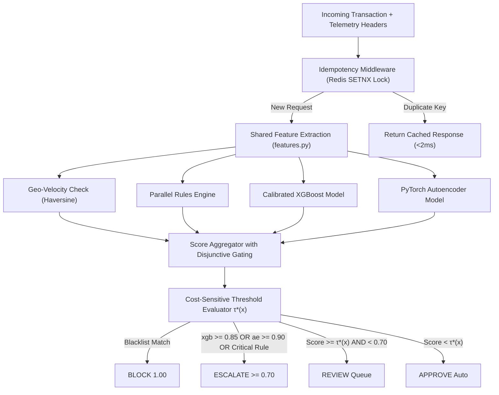

# 02 — System Architecture & Technical Specification

### 1. Monorepo Directory Structure
```text
fraud-detection-intelligence-platform/
├── backend/
│   ├── app/
│   │   ├── main.py                     # FastAPI application entrypoint, CORS, lifespan model loader
│   │   ├── config.py                   # Pydantic Settings (Supabase, Upstash Redis, DuckDB paths, JWT)
│   │   ├── api/
│   │   │   ├── routes_scoring.py       # POST /api/v1/score/live, POST /api/v1/score/batch
│   │   │   ├── routes_warehouse.py     # GET /api/v1/warehouse/metrics, GET /api/v1/warehouse/leakage-audit
│   │   │   ├── routes_ops.py           # POST /api/v1/escalations/{id}/claim, POST /api/v1/escalations/{id}/resolve
│   │   │   ├── routes_graph.py         # GET /api/v1/graph/ego/{account_id} (1-hop Mule Ring)
│   │   │   ├── routes_drift.py         # GET /api/v1/drift/psi (Model Drift PSI & KS Monitor)
│   │   │   └── routes_health.py        # GET /api/v1/health (Supabase DB, Redis, DuckDB, ML weights)
│   │   ├── middleware/
│   │   │   └── idempotency.py          # IETF Idempotency-Key middleware with Redis SETNX locking
│   │   └── services/
│   │       ├── cache.py                # Upstash Redis client + in-memory Python dict fallback
│   │       ├── rules_engine.py         # Parallel deterministic rules (blacklist, velocity, UPI limits)
│   │       ├── aggregator.py           # aggregate_score() with disjunctive override gating
│   │       ├── cost_sensitive.py       # Bayes Minimum Risk dynamic threshold evaluator
│   │       ├── geo_velocity.py         # Haversine impossible travel speed checker
│   │       ├── drift_monitor.py        # PSI & KS-statistic model drift governance
│   │       └── auth_guard.py           # Supabase JWT signature verification & role extraction
│   ├── ml/
│   │   ├── features.py                 # SINGLE SHARED FEATURE MODULE (pure logic + state providers)
│   │   ├── train_pipeline.py           # Reproducible benchmark training script (XGBoost + Autoencoder)
│   │   ├── warm_start.py               # Periodic warm-start fine-tuning & ae_minmax.json updater
│   │   ├── explain.py                  # TreeSHAP (via base estimator extraction) + Autoencoder error breakdown
│   │   └── artifacts/                  # Versioned model artifacts
│   │       ├── xgb_calibrated.joblib   # CalibratedClassifierCV wrapper
│   │       ├── autoencoder.pt          # PyTorch Dense(N->100->20->100->N) weights
│   │       ├── ae_minmax.json          # Normalization bounds (ae_min, ae_max, tau)
│   │       ├── metrics.json            # Exact evaluation metrics output from training
│   │       └── ref_score_dist.npy      # Reference training score distribution for PSI drift monitor
│   └── warehouse/
│       ├── duckdb_manager.py           # In-process DuckDB OLAP connector
│       └── data/
│           ├── paysim_warehouse.parquet# 6.36M PaySim transactions in columnar Parquet
│           ├── upi_india_20k.parquet   # 20K supplementary Indian UPI transactions
│           └── scored_test.parquet     # 50K held-out scored test slice for threshold simulation
├── frontend-dashboard/                 # Next.js 14+ (App Router) + Tailwind CSS + shadcn/ui
│   ├── app/
│   │   ├── (auth)/login/page.tsx       # Login page + Viva Evaluator Quick-Login Drawer
│   │   ├── dashboard/
│   │   │   ├── analyst/page.tsx        # Branch Analyst Workbench (Live feed, Whitebox badges, Mule Ring)
│   │   │   ├── escalations/page.tsx    # Senior Analyst Escalation Queue (15-min SLA state machine)
│   │   │   ├── team-lead/page.tsx      # Team Lead Dashboard (Telemetry, KPIs, Simulator, Drift Monitor)
│   │   │   └── admin/page.tsx          # Admin Operations (Batch Parquet upload, model registry, warm-start)
│   │   └── simulator/page.tsx          # Standalone-capable Live Simulator route (5 attack presets)
├── notebooks/
│   └── Review2_Reproducible_Benchmark.ipynb # Verified training notebook producing Review 2 numbers
├── supabase/
│   ├── migrations/
│   │   └── 001_init_schema_and_rls.sql # 7-table Postgres DDL, SECURITY DEFINER functions, 3-tier RLS
│   └── seed.sql                        # 5 branches, 4 demo users, merchants, active model, seed mule ring
└── docs/                               # The 6 Vibe-Coding Context Files + PDF Exporter
```

---

### 2. HTAP Storage Architecture (DuckDB OLAP + Supabase OLTP)

To satisfy modern enterprise FinTech design patterns while remaining lightweight and reproducible:
1. **DuckDB (Analytical Data Warehouse / OLAP):**
   * Operates entirely in-process (`duckdb_manager.py`). Directly queries columnar `.parquet` files on disk without needing a heavyweight external database server.
   * Scans all **6,362,620 rows in <150 ms** on standard laptop hardware.
   * Powers:
     * Sub-second executive KPI aggregations across 30 simulated days.
     * The **Data Leakage Audit comparison** (side-by-side performance of leaked vs. behavioral models).
     * The **Financial Impact & Threshold Simulator**, querying the pre-scored held-out test split (`scored_test.parquet`, 50,000 rows) to ensure threshold adjustments reflect true generalization rather than training set memorization.
2. **Supabase PostgreSQL (Operational RiskOps Store / OLTP):**
   * Manages active operational transactions, escalations, analyst review decisions, and audit trails.
   * Broadcasts low-latency WebSocket events to the frontend via **Supabase Realtime** (leveraging Postgres Write-Ahead Log logical replication).
   * Enforces rigorous 3-tier **Row-Level Security (RLS)** using `SECURITY DEFINER` authentication functions.

---

### 3. Shared Feature Engineering & Serving Skew Prevention (`features.py`)

* **Architectural Invariant:** To prevent training/serving skew (identified by Stripe Engineering as the leading source of silent fraud model failure), all feature transformations are implemented as pure mathematical functions in `backend/ml/features.py`.
* **Decoupled State Providers:**
  * **Batch Path (Training / Backtesting):** State (rolling velocity, historical averages) is computed via Pandas/Polars window aggregations over sorted historical steps.
  * **Live Path (API Serving / Simulator):** State is queried in real time from Upstash Redis (with an automatic in-memory Python dictionary fallback).
* **Parity Test Harness:** `test_feature_parity.py` validates that replaying 500 identical historical transactions through both the batch transformer and live Redis state provider yields bit-identical feature arrays.

#### Production Behavioral Features (Strictly Zero Data Leakage):
1. `amount`: Transaction value in INR (or normalized numerical unit).
2. `type_encoded`: One-hot encoded categorical vector (`TRANSFER`, `CASH_OUT`, `PAYMENT`, `CASH_IN`, `DEBIT`, `UPI_P2P`, `UPI_MERCHANT`).
3. `hour_of_day`: `step % 24` (or `timestamp.hour`), capturing midnight and off-hour transaction anomalies.
4. `tx_velocity_1h`: Number of transactions initiated by `nameOrig` in the trailing 1-hour window.
5. `tx_velocity_24h`: Number of transactions initiated by `nameOrig` in the trailing 24-hour window.
6. `amount_zscore`: `(amount - hist_mean) / (hist_std + 1.0)`, capturing deviations from sender baseline.
7. `balance_drain_ratio`: `amount / (oldbalanceOrg + 1.0)`.
   * *Domain Insight:* In PaySim, **98.05% of fraudulent transactions completely evacuate the victim's account** (`newbalanceOrig == 0`). `balance_drain_ratio` captures this authentic behavioral anomaly causally using only pre-transaction data, without peeking into future post-transaction balances.
8. `is_transfer_to_cashout_chain`: Backward-looking causal indicator: triggers if `nameOrig` is initiating a `CASH_OUT` within 2 hours of having received a prior `TRANSFER`.

#### Forbidden Leaked Features:
* `errorBalanceDest = oldbalanceDest + amount - newbalanceDest` and `errorBalanceOrig = oldbalanceOrg - amount - newbalanceOrig` are **strictly barred** from production training and live scoring. These features are only computed in the `/warehouse/leakage-audit` endpoint for comparative academic demonstration.

---

### 4. Hybrid Scoring Pipeline & Disjunctive Override Aggregator

The scoring engine executes three evaluation layers in parallel, augmented by cost-sensitive thresholding and geo-velocity telemetry:



1. **Idempotency Middleware (`middleware/idempotency.py`):**
   * Intercepts `POST /api/v1/score/live` requests. Checks the `Idempotency-Key` HTTP header against Redis.
   * If a previous response is cached, returns it immediately in <2 ms without re-running inference.
   * If the key is new, acquires an atomic distributed lock (`SET lock:idemp:<key> <worker_id> NX EX 30`) to prevent concurrent scoring of the same transaction from duplicate network retries.
2. **Parallel Rules Engine (`rules_engine.py`):**
   * Critical check: matches `nameOrig`, `nameDest`, card token, or VPA against confirmed fraud blacklists.
   * Behavioral flags: velocity spikes (`tx_velocity_1h >= 5`), large transfers exceeding UPI caps (`amount > ₹1,00,000`).
3. **Supervised Classifier (`xgb_calibrated.joblib`):**
   * XGBoost trained with `scale_pos_weight` and calibrated via `CalibratedClassifierCV(method='sigmoid', cv='prefit')` on an **untouched validation split** (preserving the natural 0.129% base rate to prevent artificial probability inflation).
   * Outputs calibrated posterior probability `xgb_prob ∈ [0.0, 1.0]`.
4. **Unsupervised Autoencoder (`autoencoder.pt`):**
   * Fully connected architecture: `Input(N) -> Linear(N, 100) -> ReLU -> Linear(100, 20) -> ReLU -> Linear(20, 100) -> ReLU -> Linear(100, N)`.
   * Trained exclusively on legitimate transactions (`isFraud == 0`, 20 epochs, MSE loss converging `0.286 -> 0.004`).
   * Computes per-feature squared reconstruction errors $(x_i - \hat{x}_i)^2$ and mean squared error $MSE$.
   * Normalized onto $[0, 1]$ via train-time bounds: `ae_norm = clip((mse - ae_min) / (ae_max - ae_min), 0.0, 1.0)`.
5. **Geo-Velocity Checker (`geo_velocity.py`):**
   * Computes the spherical Haversine distance between the current transaction's geolocated IP and the account's previous transaction location.
   * If the calculated physical travel speed exceeds **900 km/h** (commercial jet cruising speed), a `geo_velocity_anomaly` flag is raised with a +0.35 risk boost injected into the aggregator.
   * Generates a Whitebox badge: `⚡ Impossible Travel: 1,420 km/h between Kolkata and Mumbai`.
6. **Score Aggregator with Disjunctive Gating (`aggregator.py`):**
   * Solves the mathematical limitation of naive weighted averages (where a severe anomaly in one model could be suppressed by a normal score in the other). Employs **Disjunctive Gating**:

```python
def aggregate_score(rules_result, xgb_prob: float, ae_mse: float, ae_min: float, ae_max: float,
                    geo_velocity_boost: float = 0.0) -> tuple[str, float, str]:
    # 1. Hard Rule: Confirmed Blacklist Match -> Autonomous BLOCK
    if rules_result.is_blacklisted:
        return "BLOCK", 1.0, "Critical Rule: Confirmed Blacklisted Entity Match"

    # 2. Critical Rule Override -> Immediate ESCALATE
    if rules_result.critical_hit:
        return "ESCALATE", 0.95, f"Critical Rule Override: {rules_result.primary_reason}"

    # 3. Normalize Autoencoder MSE onto [0, 1] scale
    ae_norm = max(0.0, min(1.0, (ae_mse - ae_min) / max(1e-6, (ae_max - ae_min))))

    # 4. Disjunctive Model Gating (Specialized Detector Escapes)
    # If supervised model has extreme confidence in known fraud pattern:
    if xgb_prob >= 0.85:
        combined = max(0.75, float(xgb_prob))
        return "ESCALATE", round(combined, 4), f"Supervised High Confidence Fraud Signature (p={xgb_prob:.2f})"

    # If unsupervised autoencoder detects severe zero-day reconstruction novelty:
    if ae_norm >= 0.90:
        combined = max(0.75, float(ae_norm))
        return "ESCALATE", round(combined, 4), f"Unsupervised Severe Zero-Day Anomaly (AE Norm={ae_norm:.2f})"

    # 5. Weighted Combination for moderate multi-signal cases
    combined = (0.60 * float(xgb_prob)) + (0.40 * ae_norm) + rules_result.soft_flag_boost + geo_velocity_boost
    combined = round(min(1.0, max(0.0, combined)), 4)

    # 6. Final Decision Routing Bands
    if combined < 0.30:
        verdict = "APPROVE"
    elif combined < 0.70:
        verdict = "REVIEW"
    else:
        verdict = "ESCALATE"

    return verdict, combined, rules_result.primary_reason
```

7. **Cost-Sensitive Dynamic Threshold Evaluator (`cost_sensitive.py`):**
   * After the aggregator produces a `combined_score`, the cost-sensitive evaluator computes the Bayes Minimum Risk cutoff τ*(x) specific to the transaction's monetary value.
   * If `combined_score >= τ*(x)` but the static band says `APPROVE`, the evaluator overrides to `REVIEW`.
   * This ensures high-value transactions receive proportionally greater scrutiny, while low-value transactions avoid unnecessary friction.

```python
class CostSensitiveEvaluator:
    def __init__(self, cost_review=150.0, cost_friction=200.0, chargeback_fee=1500.0, interchange_margin=0.015):
        self.c_review = cost_review
        self.c_friction = cost_friction
        self.c_fee = chargeback_fee
        self.interchange = interchange_margin

    def get_dynamic_threshold(self, amount: float) -> float:
        c_fp = self.c_review + self.c_friction + (self.interchange * amount)
        c_fn = amount + self.c_fee
        optimal_tau = c_fp / (c_fp + c_fn)
        return round(max(0.01, min(0.85, optimal_tau)), 4)

    def apply(self, amount: float, combined_score: float, static_verdict: str) -> tuple[str, float]:
        tau = self.get_dynamic_threshold(amount)
        if static_verdict == "APPROVE" and combined_score >= tau:
            return "REVIEW", tau
        return static_verdict, tau
```

---

### 5. Explainable AI (XAI) Implementation Details (`explain.py`)

* **TreeSHAP Extraction from `CalibratedClassifierCV`:**  
  Standard SHAP `TreeExplainer` throws an exception when passed a scikit-learn `CalibratedClassifierCV` wrapper. `explain.py` extracts the underlying base XGBoost estimator:
  ```python
  import shap

  def get_tree_explainer(calibrated_model):
      # Extract base fitted XGBoost estimator from calibration wrapper
      base_estimator = calibrated_model.calibrated_classifiers_[0].estimator
      return shap.TreeExplainer(base_estimator)
  ```
* **Plain-English Badge Translation:**  
  * The top 3 positive SHAP features are mapped to clear human-readable strings (e.g., `tx_velocity_1h` → `"High 1-Hour Velocity"`).
  * Autoencoder reconstruction errors are analyzed: if $(x_i - \hat{x}_i)^2$ for `balance_drain_ratio` accounts for $>50\%$ of total MSE, a badge `"Unusual Account Evacuation"` is generated.
  * **Geo-Velocity Badge:** If the Haversine impossible travel check triggers, a badge `"⚡ Impossible Travel: {speed} km/h between {city_A} and {city_B}"` is appended to the `whitebox_insights` JSON array.

---

### 6. Continuous Learning via Periodic Warm-Start Fine-Tuning (`warm_start.py`)

* **Eliminating Real-Time Online Learning Catastrophic Forgetting:**  
  Real-time per-transaction weight updates cause neural network catastrophe. Instead, we implement **Periodic Warm-Start Fine-Tuning**:
  1. A scheduled/admin task queries transactions from `analyst_actions` where analysts confirmed `false_positive` (genuine customer transactions mistakenly flagged).
  2. Loads existing weights from `autoencoder.pt`.
  3. Trains for 3 fine-tuning epochs with a reduced learning rate ($10^{-4}$) exclusively on confirmed normal transactions.
  4. Saves updated weights and recomputes `ae_minmax.json` (`ae_min`, `ae_max`, and decision threshold $\tau$) to prevent normalization drift.
* **Delayed Feedback Awareness:**  
  The warm-start pipeline enforces a **60-day Observation Blackout Window** to prevent label contamination from unconfirmed chargeback data:
  * *Matured Training Window* [T − 365d, T − 60d]: Fully confirmed ground truth labels available.
  * *Observation Blackout Window* [T − 60d, T]: Excluded from supervised model retraining (chargeback disputes may still be maturing).
  * *Live Serving Window* [T, now]: Inference only; analyst feedback provides active learning labels.

---

### 7. Model Drift Governance & Compliance (`drift_monitor.py`)

* **Regulatory Foundation:** Federal Reserve SR Letter 11-7 and Basel II Accord mandate continuous model risk monitoring for financial institutions. ASTID implements automated drift surveillance via two complementary statistical tests.
* **Population Stability Index (PSI):**
  * Partitions model scores into 10 decile bins based on a frozen reference distribution (`ref_score_dist.npy`, captured from the training validation split).
  * Computes: $\text{PSI} = \sum_{i=1}^{10} (A_i - E_i) \times \ln(A_i / E_i)$
  * Traffic-light governance:
    * PSI < 0.10 → GREEN (stable; no action).
    * 0.10 ≤ PSI < 0.25 → AMBER (moderate drift; warning logged to Team Lead dashboard, warm-start scheduled).
    * PSI ≥ 0.25 → RED (severe drift; circuit breaker alert, automated warm-start recalibration triggered).
* **Two-Sample Kolmogorov-Smirnov (KS) Test:**
  * Runs alongside PSI as a non-parametric statistical confirmation. Reports the KS statistic and p-value.
  * If KS p-value < 0.01 with PSI ≥ 0.25, the drift alert is classified as statistically confirmed.
* **Endpoint:** `GET /api/v1/drift/psi` — returns the latest PSI value, KS statistic, traffic-light status, and recommended action.

---

### 8. IETF Idempotency-Key Middleware (`middleware/idempotency.py`)

* **Problem Statement:** Payment networks operate over unreliable mobile connections. When a user taps "Pay" on UPI and the connection drops, the client retries. Without strict idempotency, the backend might score the transaction twice, trigger artificial velocity spikes, or execute duplicate ledger deductions.
* **Implementation Contract:**
  1. Client sends `Idempotency-Key: <uuid>` in the HTTP request header.
  2. Middleware attempts an atomic Redis lock: `SET lock:idemp:<key> <worker_id> NX EX 30`.
     * If the key exists and the status is `COMPLETED`, the cached JSON response is returned directly from Redis in <2 ms without running ML inference.
     * If the key exists and the status is `PROCESSING`, return `409 Conflict` ("Request in flight").
  3. On successful scoring, the full response is serialized and cached in Redis with a 72-hour TTL.
  4. The lock is safely released in a `finally` block.
* **Database-Level Backup:** The Supabase `ON CONFLICT (ingestion_hash) DO UPDATE SET updated_at = now() RETURNING *` ensures idempotency even if the Redis layer is unavailable (crash-proof fallback).
